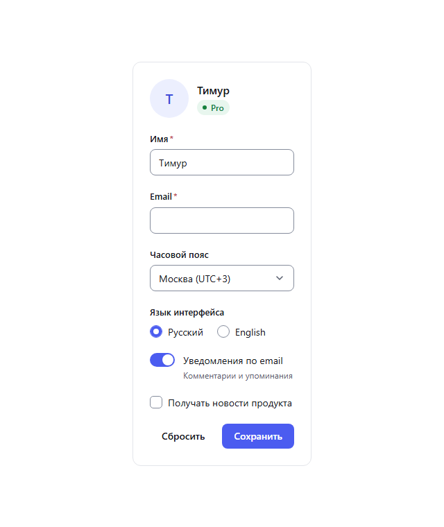
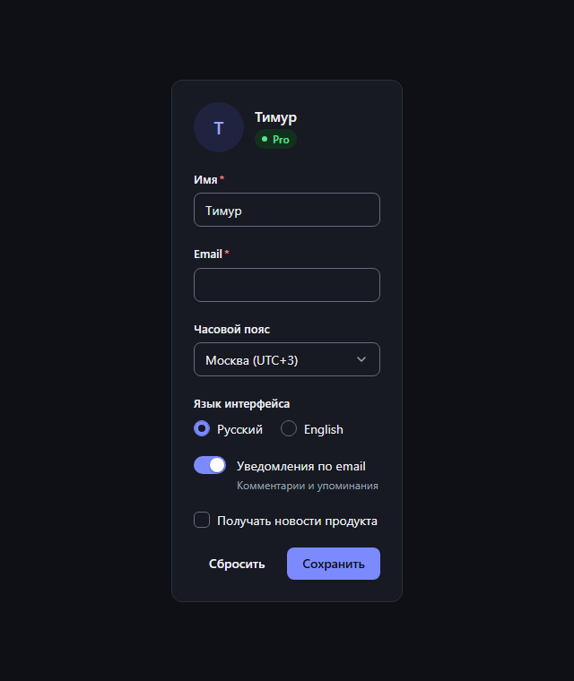

# Nova UI

[](https://github.com/Qwertyzxas/nova-ui/actions/workflows/ci.yml)

Дизайн-система и библиотека React-компонентов. Все компоненты доступны с клавиатуры и для экранных читалок, поддерживают светлую и тёмную темы, а цвета построены на токенах с проверенным контрастом.

**[▶ Документация в Storybook](https://qwertyzxas.github.io/nova-ui/)**: живые примеры, таблицы токенов и проверка доступности для каждой истории.

| Светлая тема | Тёмная тема |
| --- | --- |
|  |  |

## Компоненты

| Группа | Компоненты |
| --- | --- |
| Действия | `Button` (4 варианта × 3 тона × 3 размера, состояние загрузки), `Spinner` |
| Формы | `TextField` (поле и textarea), `Select`, `Checkbox` (с `indeterminate`), `Switch`, `RadioGroup` |
| Навигация и раскрытие | `Tabs`, `Accordion` |
| Оверлеи | `Dialog`, `Tooltip`, `Toast` |
| Отображение | `Badge`, `Avatar` |

Поведение интерактивных компонентов следует [WAI-ARIA Authoring Practices](https://www.w3.org/WAI/ARIA/apg/):

- **Select** реализует select-only combobox: фокус остаётся на кнопке, подсвеченный пункт передаётся через `aria-activedescendant`. Работают стрелки, `Home`/`End`, поиск по первым буквам (повторное нажатие той же буквы перебирает совпадения), `Tab` фиксирует выбор.
- **Tabs** используют roving tabindex: стрелки переключают вкладки, `Tab` сразу уходит в содержимое. Есть вертикальный режим.
- **Dialog** построен на нативном `<dialog>`: ловушку фокуса, `Esc` и возврат фокуса даёт браузер. Пока диалог открыт, прокрутка страницы заблокирована.
- **Tooltip** соответствует WCAG 1.4.13. Подсказку можно «поймать» курсором, `Esc` её скрывает, а показ по фокусу срабатывает только при `:focus-visible`.
- **Toast** выводит уведомления в polite live region. Таймер ставится на паузу, пока курсор или фокус внутри уведомлений.

Компоненты с состоянием работают и в управляемом, и в неуправляемом режиме (например, `value` + `onValueChange` или `defaultValue`) и принимает `ref` как обычный проп (React 19).

## Установка

```bash
npm install @qwertyzxas/nova-ui
```

```tsx
import { Button, Select, ToastProvider, useToast } from '@qwertyzxas/nova-ui';
import '@qwertyzxas/nova-ui/styles.css';

function SaveButton() {
  const { toast } = useToast();
  return <Button onClick={() => toast({ title: 'Сохранено', tone: 'success' })}>Сохранить</Button>;
}

export function App() {
  return (
    <ToastProvider label="Уведомления">
      <Select
        label="Город"
        placeholder="Выберите город"
        options={[
          { value: 'msk', label: 'Москва' },
          { value: 'spb', label: 'Санкт-Петербург' },
        ]}
      />
      <SaveButton />
    </ToastProvider>
  );
}
```

React 18.2+ и 19 указаны как peer-зависимости. Пакет распространяется как ES-модуль с типами: JS весит 8,4 КБ в gzip, CSS 4,5 КБ.

## Темы и токены

Тема выбирается по системной настройке (`prefers-color-scheme`). Чтобы задать её явно, поставьте атрибут на любой предок:

```html
<html data-nova-theme="dark">
```

Все значения хранятся как CSS-переменные (`--nova-color-accent`, `--nova-space-4`, `--nova-radius-md` и т. д.), поэтому их можно переопределить под свой бренд без пересборки.

Единственный источник токенов — [`src/tokens/tokens.ts`](src/tokens/tokens.ts). Из него скрипт `npm run tokens` генерирует `tokens.css`. Тест проверяет две вещи:

- сгенерированный CSS не расходится с исходником;
- **контраст каждой значимой пары цветов в обеих темах** соответствует WCAG: 4.5:1 для текста и 3:1 для границ полей, кольца фокуса и других элементов интерфейса (WCAG 1.4.11).

Если поменять цвет так, что он перестанет читаться, CI упадёт.

## Тесты

| Уровень | Инструмент | Что проверяется |
| --- | --- | --- |
| Юнит и интеграция | Vitest, Testing Library, user-event | клавиатура, ARIA-атрибуты, управляемые и неуправляемые режимы, таймеры уведомлений, позиционирование подсказки |
| Доступность в jsdom | vitest-axe | разметка компонентов в разных состояниях проходит axe |
| Доступность в браузере | Playwright, axe-core | **каждая история Storybook в обеих темах** проверяется по WCAG 2.1 AA, включая реальный контраст отрисованных цветов |
| Токены | Vitest | контраст по WCAG и синхронизация CSS с исходником |

```bash
npm test                 # 83 юнит-теста
npm run build-storybook  # статическая документация
npm run e2e              # 62 проверки в Chromium: доступность и контролы
```

CI в GitHub Actions на каждый пуш проверяет типы, гоняет тесты, собирает библиотеку, проверяет содержимое npm-пакета (`npm pack --dry-run`) и публикует Storybook на GitHub Pages. Тег вида `v0.2.0` запускает публикацию в npm с provenance.

## Разработка

```bash
npm install
npm run storybook   # http://localhost:6006
npm run build       # dist/: index.js, styles.css, .d.ts
```

```
src/
  tokens/       токены, генерация CSS, расчёт контраста
  styles/       сгенерированные токены и базовые стили
  components/   компоненты, их стили, истории и тесты
  utils/        useControllableState, mergeRefs, cx
  docs/         MDX-страницы Storybook и пример формы
e2e/            проверка всех историй через axe в Playwright
```

## Лицензия

[MIT](LICENSE)
